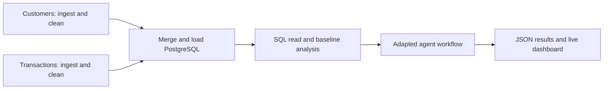
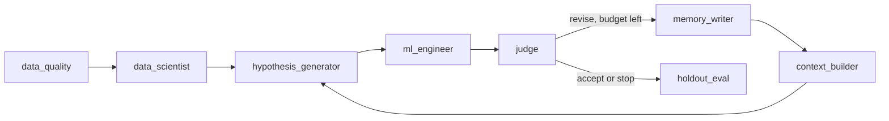

# Week 11: Orchestrated fraud detection

This submission adapts the in-class AutoML Research Lab for the required Part 1 and Part 2. Optional Part 3 is outside this submission. All new assignment files live in `week11/`, the DAG in `airflow/dags/week11_fraud_pipeline.py`, and the modified agents in `student_loop/graph.py`.

## Run

Start Docker Desktop, then from the repository root:

```bash
docker compose -f week11/compose.yml up --build -d
```

Open http://localhost:8088 (admin / admin), unpause **week11_fraud_pipeline**, and trigger it once. It also runs daily at **07:00 UTC** (`0 7 * * *`); `catchup=False` avoids historical backfills. Two independent cleaning tasks run concurrently under LocalExecutor; the merge waits for both. One active DAG run avoids overlapping publication. Failures retry once after 15 seconds.

Open http://localhost:8501 for the compiled agent graph, quality checks, validation trials, and holdout metrics. Click **Run adapted agents** to watch node states update during a fresh real execution. The graph is generated from `build_graph().get_graph()` rather than a separately maintained drawing.

```bash
# Tests inside the exact container environment
docker compose -f week11/compose.yml exec scheduler python -m pytest /repo/tests/unit/test_week11.py /repo/tests/unit/test_student_loop.py -q
# DAG import diagnostics
docker compose -f week11/compose.yml exec scheduler airflow dags list-import-errors
# Stop, preserving the database
docker compose -f week11/compose.yml down
```

Ports bind to localhost. Development credentials are for this local assignment. No paid API or LLM key is required: agents use the classroom deterministic fallback. This is a LangGraph workflow with distinct agent responsibilities, not evidence of a live LLM call.

## Data and transformations

The two related tables are the repository's `datasets/airflow/customers.csv` and `transactions.csv`. The classroom attribution identifies them as **synthetic educational data** from Financial Transaction Intelligence Dataset 2026, Kaggle (`roshaaann30/financial-transaction-intelligence-dataset-2026`), CC BY-NC-SA 4.0; see `datasets/airflow/ATTRIBUTION.md`. Claims about fraud performance apply only to this synthetic dataset.

Each branch reads its source, removes exact duplicates, trims strings, checks required fields and unique keys, and writes a run-specific cleaned file. Transactions also parse timestamps and amounts, reject negative amounts and nonbinary labels, and remove `fraud_probability` because it may reveal label generation. Customers validate age and numeric income/credit-score fields. Conflicting duplicate keys fail rather than silently choose a record.

A many-to-one left join on `customer_id` preserves one row per transaction and rejects unmatched customer references. PostgreSQL database **fraud** stores the full merged table `fraud_transactions`; a unique `(pipeline_run, transaction_id)` index prevents duplication. `week11_runs` records row counts. A retry replaces only its own snapshot transactionally. The Airflow metadata database is separate.

The analysis task reads the persisted run back using SQL, checks the row count, aggregates fraud rate by payment method, and selects a deterministic sample of at most 2,000 rows (seed 42) for responsive training. Full-table SQL aggregates remain available in `payment_analysis.csv`.



## Agent modifications and evaluation

The student skeleton now implements the seven classroom agents and adds a **data_quality** node before profiling. It rejects duplicate records, missing/duplicate transaction IDs, invalid labels, and insufficient per-class counts. The scientist profiles features; hypothesis proposes the next experiment; the engineer trains; judge evaluates validation evidence; memory/context carry previous lessons into a new experiment. Routing stops at acceptance or the three-cycle budget.

Identifiers, timestamps, and `fraud_probability` are excluded from model features. Mandatory drops are enforced even if an optional LLM profile omits them. Preprocessing (imputation and categorical encoding) fits only on the training portion. A deterministic stratified split reserves 20% as holdout; the remaining 80% splits into 60% training and 20% validation. All experiments use identical partitions. After selecting the best validation F1, the model refits on the development portion and evaluates the holdout once. The baseline reports validation metrics; Part 2 reports final holdout metrics. Random row splitting measures within-sample performance, not future-time or unseen-customer generalization.

The shared scoring helper now reports **precision, recall, F1, accuracy, and a confusion matrix**. F1 is the selection metric because high accuracy alone can hide missed fraud. The matrix uses true labels on rows, predicted labels on columns, and label order `[0,1]`.



## Results and evidence

Run artifacts are under `outputs/week11/<run timestamp>/`: cleaned source files, `database_cleaned.csv` exported from PostgreSQL, `payment_analysis.csv`, `analysis.json`, and `agent_results.json`. The live dashboard can save a separate `dashboard_agent_results.json`.

See `RESULTS.md` for verified numbers and execution status. Screenshots under `outputs/week11/screenshots/` document the actual Airflow run, DAG dependencies, adapted agent graph, and model results. Do not substitute reference classroom screenshots.

The root README is the assignment summary. Original instructor instructions are preserved in `README.classroom.md`.


## Troubleshooting

- If `localhost:8088` or `localhost:8501` does not load, run `docker compose -f week11/compose.yml ps` and `docker compose -f week11/compose.yml logs --tail 80 webserver scheduler dashboard`. Wait for initial database migrations and the webserver to finish starting.
- If another classroom stack occupies a port, stop that stack or change only the host side of the port mapping in `week11/compose.yml`, then use the new port.
- If a task is red, inspect its Airflow task log, correct the reported source or environment problem, and clear/retry that task. Source-validation failures intentionally stop the merge.
- If the dashboard has no new results, complete the Airflow DAG and refresh the page. Saved screenshots/JSON describe the verified run; fresh runs write a new timestamp directory.
- The independent Part 2 CLI is `docker compose -f week11/compose.yml exec scheduler python -m week11.run_agents`. It uses the latest published Part 1 analysis unless `--run-id` selects another completed run.
