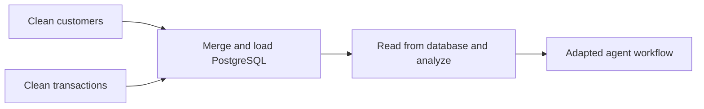
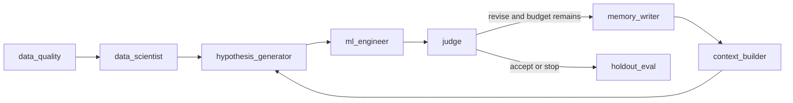
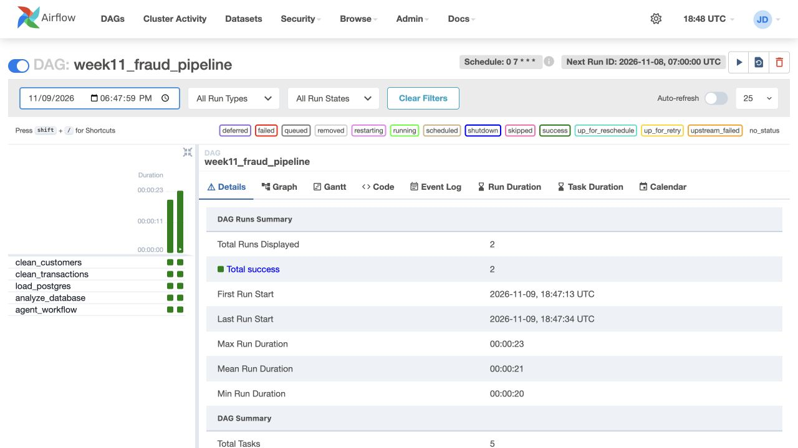
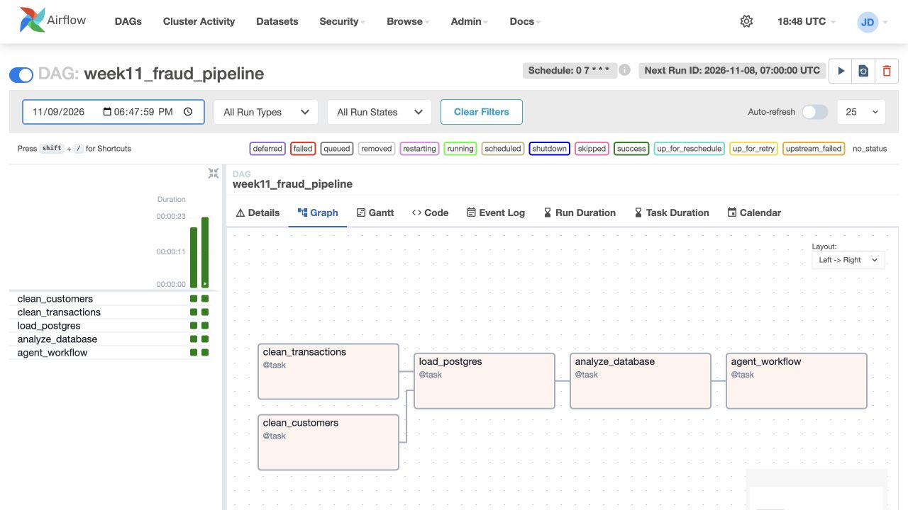
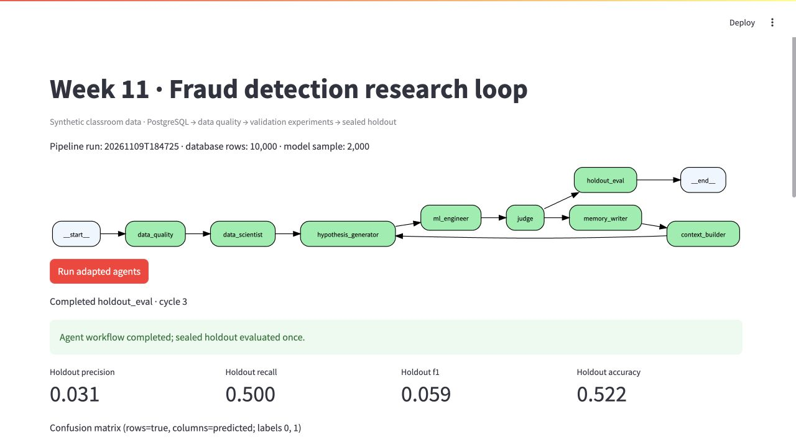
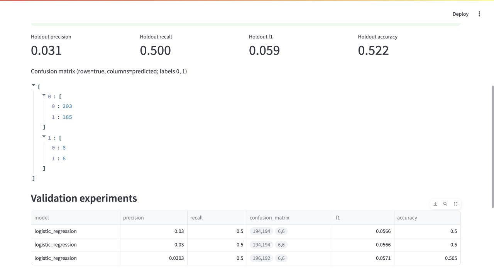
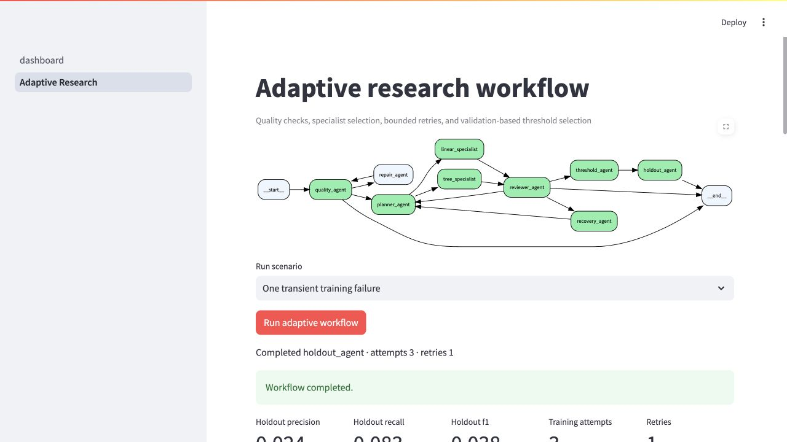
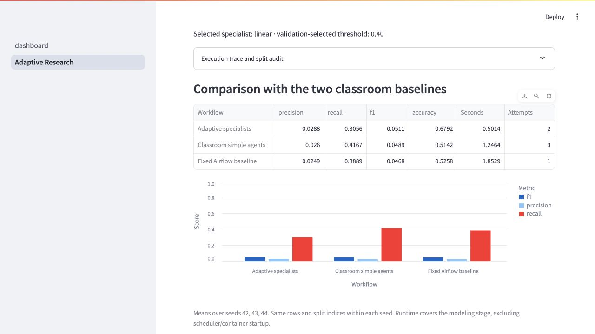
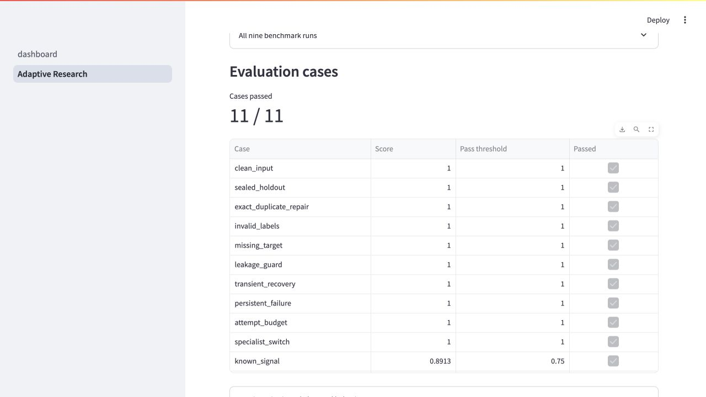

# Week 11: Fraud Detection with Airflow and LangGraph

**Author:** Jacey Dai · IDS 706 · Parts 1–3

An end-to-end data pipeline cleans two related tables in parallel, merges them into PostgreSQL, reads the stored data for analysis, and runs an adapted agent-based machine learning loop. This project extends the [in-class AutoML Research Lab](https://github.com/Kedar-V/automl-research-lab); the original classroom instructions are preserved in [README.classroom.md](../README.classroom.md).

## Submission checklist

| Requirement | Included evidence |
| --- | --- |
| Scheduled Airflow DAG, ingestion through analysis | [Assignment DAG](../airflow/dags/week11_fraud_pipeline.py), daily at 07:00 UTC |
| Two related datasets, independently cleaned in parallel | Customer and transaction branches in [pipeline.py](../week11/pipeline.py) |
| Merge, database load, and analysis from the database | PostgreSQL snapshot loading, SQL readback, payment-method aggregation, and baseline model |
| Modified agents and updated live graph | [Agent implementation](../student_loop/graph.py), new data-quality node, [live dashboard](../week11/dashboard.py) |
| Containerized setup and run instructions | [Dockerfile](../week11/Dockerfile), [Compose](../week11/compose.yml), commands below |
| Four required screenshot categories | [Airflow success](../outputs/week11/screenshots/01_airflow_success.jpg), [DAG graph](../outputs/week11/screenshots/02_airflow_dag_graph.jpg), [agent graph](../outputs/week11/screenshots/03_live_agent_graph.jpg), [model evaluation](../outputs/week11/screenshots/04_model_evaluation.jpg) |
| Pipeline, modifications, and findings | This README, [process details](../week11/README.md), and [verified results](../week11/RESULTS.md) |

## Run both workflows

Prerequisites: Git and a running Docker Desktop with Docker Compose. Everything runs inside Docker; no host Python or Airflow installation is required. Ports 8088 and 8501 must be available.

```bash
git clone https://github.com/Jacey-Dai/IDS706-Week11-Orchestration.git
cd IDS706-Week11-Orchestration
docker compose -f week11/compose.yml up --build -d
```

**Part 1:** Open [Airflow](http://localhost:8088), sign in with `admin` / `admin`, unpause `week11_fraud_pipeline`, and click **Trigger DAG**. Wait for all five tasks to turn green. The final task also executes Part 2 automatically. The first image build can take several minutes.

**Part 2:** Open the [agent dashboard](http://localhost:8501). Click **Run adapted agents** to rerun the adapted LangGraph workflow on the CSV exported from PostgreSQL by Part 1. The actual compiled graph shows running/completed node states; the page displays validation trials and final holdout metrics. Saved outputs and screenshots are included as evidence of the verified November 9 run. To create a new database snapshot, run Part 1 first.

Optional command-line rerun of Part 2 after Part 1:

```bash
docker compose -f week11/compose.yml exec scheduler python -m week11.run_agents
```

Validation and shutdown:

```bash
docker compose -f week11/compose.yml exec scheduler python -m pytest /repo/tests/unit/test_week11.py /repo/tests/unit/test_student_loop.py -q
docker compose -f week11/compose.yml exec scheduler airflow dags list-import-errors
docker compose -f week11/compose.yml exec scheduler python -m week11.check_roundtrip
docker compose -f week11/compose.yml down
```

`down` preserves the database volume. Local development credentials are scoped to this assignment; published ports bind to localhost. See [troubleshooting](../week11/README.md#troubleshooting) if a port is already occupied or a task fails.

## Pipeline and data

The two source tables are [customers.csv](../datasets/airflow/customers.csv) and [transactions.csv](../datasets/airflow/transactions.csv), joined by `customer_id`. The classroom attribution identifies them as **synthetic educational data** from Financial Transaction Intelligence Dataset 2026 (Kaggle), under CC BY-NC-SA 4.0. See [data attribution](../datasets/airflow/ATTRIBUTION.md).

Each branch removes exact duplicate rows, trims strings, validates identifiers and required fields, and writes a run-specific cleaned file. Customers validate age and numeric fields; transactions parse timestamps and amounts and validate binary fraud labels. Conflicting keys or unmatched customers fail the run. `fraud_probability` is removed as a potential target-leakage field.

The merge validates a many-to-one customer relationship, then writes the full result to the `fraud` PostgreSQL database. A unique `(pipeline_run, transaction_id)` index and transactional replacement of each run snapshot make retries idempotent. The analysis task reads that snapshot back with SQL, checks row counts, aggregates fraud rates by payment method, and trains a baseline on a deterministic 2,000-row sample. Airflow metadata uses a separate database.



The DAG runs daily at **07:00 UTC** with `catchup=False`, one active run, and one retry per task. The customer and transaction cleaning tasks have no dependency on each other, so LocalExecutor runs them in parallel. The merge waits for both branches.

## Agent changes

The completed student loop retains the classroom scientist, hypothesis generator, ML engineer, judge, memory writer, context builder, and holdout evaluator. It adds **data_quality** before profiling to reject duplicate transactions, invalid labels, and insufficient class counts. Required leakage/identifier drops remain enforced even if an optional LLM omits them. The common scorer adds precision, recall, and a confusion matrix alongside F1 and accuracy.



The judge selects using validation F1, with a maximum of three experiments. A stratified split reserves 20% for holdout; the other 80% splits into 60% training and 20% validation. Preprocessing fits on training data. The best validation configuration refits on development data and evaluates the holdout once per workflow execution. The verified runs use deterministic rules for planning and review within LangGraph.

## Key findings

Both a scheduled run and a manual run succeeded on November 9, 2026. The database contained **10,000 transactions**, with **3.06% fraud prevalence**. Nine focused tests passed in the container; a retry reload preserved exactly 10,000 rows.

| Evaluation | Precision | Recall | F1 | Accuracy |
| --- | --- | --- | --- | --- |
| Part 1 baseline, validation | 0.0253 | 0.4167 | 0.0476 | 0.5000 |
| Part 2 selected model, holdout | 0.0314 | 0.5000 | 0.0591 | 0.5225 |

The loop selected the third logistic regression configuration by validation F1, but did **not** reach its target F1 of 0.8. On the 400-row holdout it detected 6 of 12 fraud cases, with 185 false positives. An always-nonfraud classifier would achieve 97% accuracy and zero fraud recall, showing why accuracy alone is misleading. These weak synthetic-data results do not establish a useful production fraud detector. The two rows above use different evaluation partitions and should not be interpreted as a controlled improvement comparison.

Observed full-table fraud rates ranged from 2.57% for Debit Card to 3.83% for UPI; these are descriptive associations. Limited positive examples, unscaled classroom models, and a narrow search constrain results. Random row splits also do not measure future-time or entirely new-customer performance. [Full results and limitations](../week11/RESULTS.md).

## Screenshots from successful execution

### Airflow success



### DAG graph



### Modified live agent graph



### Model evaluation



Run-level JSON evidence is stored in [outputs/week11/20261109T184725](../outputs/week11/20261109T184725). Generated cleaned CSVs can be reproduced by running the DAG. Part 3 adds adaptive routing, failure recovery, and a comparison with two classroom baselines; see the section below.


## Part 3: Adaptive research and evaluation

The [adaptive graph](../week11/part3/graph.py) assigns separate responsibilities to quality checking, duplicate repair, experiment planning, linear and tree specialists, review, recovery, threshold selection, and holdout evaluation. Conditional edges select the next agent using data quality, training status, validation F1, and remaining budgets. The topology is compiled once; the executed path changes with intermediate results.

- Exact duplicates route through repair and revalidation. Invalid labels stop before training.
- Below-target linear results route to a tree specialist. A training error routes through recovery and retries the same specialist, at most once by default.
- Training attempts are capped at three. The selected model's decision threshold uses validation labels only; holdout is evaluated once at the end of each execution.

Run the evaluation suite and comparison after Part 1:

```bash
docker compose -f week11/compose.yml exec scheduler python -m week11.part3.evaluate
```

In the [dashboard](http://localhost:8501), select **Adaptive Research** in the sidebar. Run clean-data and transient-failure scenarios, inspect the graph and trace, and view the baseline comparison and case results. [Part 3 methods and findings](../week11/part3/README.md) document every test's input, expected behavior, scoring criteria, and pass threshold.

**Evaluation:** 11/11 cases passed. Across seeds 42, 43, and 44, mean holdout F1 was 0.0511 for adaptive specialists, 0.0489 for classroom simple agents, and 0.0468 for the fixed Airflow model. Adaptive recall was lower, and the F1 differences were small relative to variation across splits. The result supports bounded routing and recovery behavior; predictive performance remains weak. [Detailed comparison](../week11/part3/RESULTS.md).






