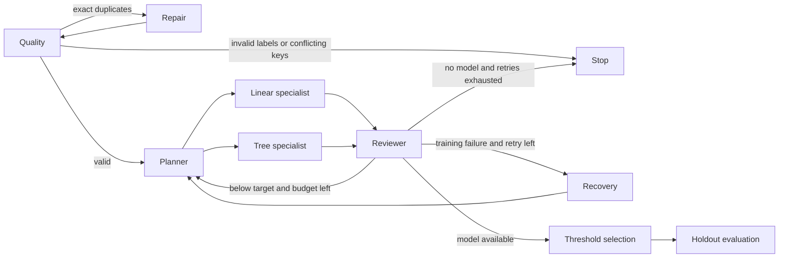

# Adaptive research workflow

This extension studies whether a research graph can choose specialists, handle bad inputs, and recover from failed steps while keeping experiment budgets and evaluation boundaries explicit.

## Run

Complete Part 1, then run:

```bash
docker compose -f week11/compose.yml exec scheduler python -m week11.part3.evaluate
```

Open http://localhost:8501 and select **Adaptive Research** in the sidebar. The page uses the actual compiled LangGraph, updates node colors during execution, and displays both saved comparisons and fresh runs. The transient-failure option injects one controlled training exception so the recovery path can be inspected. Normal runs inject no failures.

## Responsibilities and routing

| Agent | Responsibility and routing decision |
| --- | --- |
| Quality | Check labels, class support, and record integrity; continue, repair, or stop |
| Repair | Remove only exact duplicate rows and return to quality checking |
| Planner | Choose the initial linear specialist, an alternate tree specialist, or the same specialist for retry |
| Linear specialist | Train a scaled, class-balanced logistic regression pipeline |
| Tree specialist | Train a class-balanced random forest with a fixed seed |
| Reviewer | Use validation F1 and training status to continue, retry, finalize, or stop |
| Recovery | Increment the retry counter and send the failed specialist back to the planner |
| Threshold | Select a probability threshold from 0.05–0.95 using validation F1 only |
| Holdout | Refit the chosen pipeline on development data and score the held-out partition once |



The compiled topology is stable; conditional routing changes the executed path. A default run permits three training attempts, one retry, and one duplicate-repair pass. Invalid labels and conflicting transaction identifiers are not silently fixed.

## Evaluation design

The suite reads the same 2,000-row database export used in Part 2. Each case records its input, expected behavior, scoring criteria, pass threshold, observed result, and pass/fail status in `outputs/week11/part3/case_results.json`. Contract cases score 1 for satisfying every stated condition and require 1; the known-signal case scores actual holdout F1 and requires at least 0.75.

| Case | Input | Expected behavior | Scoring criterion / pass threshold |
| --- | --- | --- | --- |
| Clean input | Unmodified Part 1 sample | Complete with valid metrics | Quality passes, metrics in [0,1], exactly one holdout call; score 1 |
| Sealed holdout | Same sample | Threshold uses validation only | Disjoint indices, matching validation fingerprint, one holdout call; score 1 |
| Duplicate repair | Append five exact duplicate rows | Repair once and revalidate | One repair, original row count, completed holdout; score 1 |
| Invalid labels | Change one label to 2 | Reject before training | Rejected quality, zero training attempts and holdout calls; score 1 |
| Missing target | Remove target column | Stop with clear reason | missing_target and zero holdout calls; score 1 |
| Leakage guard | Add fraud_probability equal to the label | Exclude it and all identifier columns | No forbidden feature in any trial; score 1 |
| Transient recovery | First training attempt raises RuntimeError | Retry the same specialist and finish | One retry, failed then successful same-family trial, one holdout call; score 1 |
| Persistent failure | Every training attempt raises RuntimeError | Stop within the retry limit | Two attempts, one retry, training_failed, no holdout call; score 1 |
| Attempt budget | One attempt, target F1=1.0 | Finalize without another trial | One attempt, one trial, one holdout call; score 1 |
| Specialist switch | Clean sample, target F1=1.0 | Switch from linear to tree | Successful trial sequence [linear, tree]; score 1 |
| Known signal | Reproducible 800-row synthetic fixture with strong class separation | Recover a learnable signal | Actual holdout F1 >= 0.75 |

The fault cases use controlled exceptions, not naturally observed infrastructure failures. The signal fixture checks the scoring pipeline; it is not evidence of stronger performance on the fraud dataset. The split-audit case checks recorded partition membership alongside the threshold agent's implementation; it is not a formal security proof.

## Baselines and comparison controls

1. **Fixed Airflow baseline:** the same logistic-regression scoring procedure used by the Part 1 Airflow analysis task, with one predefined experiment and no model-selection loop.
2. **Classroom simple agents:** the unmodified `mini_loop.graph` workflow with its scientist, hypothesis, engineer, judge, memory, and holdout nodes, capped at three cycles.
3. **Adaptive specialists:** the new graph with quality repair, model specialist selection, bounded failure recovery, and validation threshold selection.

All three use the same source sample and seeds 42, 43, and 44. Within each seed, train/validation/holdout indices are identical (60/20/20); their fingerprints are recorded and checked for the adaptive graph. Models select and tune using development partitions only. The comparison records nine runs, including precision, recall, F1, accuracy, training attempts, and elapsed time.

The fixed baseline is rerun through its scoring functions rather than launching a separate scheduler for each seed. Reported runtime covers the modeling stage, excluding Airflow scheduling, container startup, and database ingestion. The adaptive system also changes scaling, model family, and threshold policy, so the comparison cannot isolate routing as the cause of any predictive difference. No external model service is called by the evaluation.

Raw comparison records, case observations, traces, and captured warnings are under `outputs/week11/part3/`. The full case definitions and expected thresholds are in [evaluate.py](evaluate.py); the graph is in [graph.py](graph.py). See [RESULTS.md](RESULTS.md) for measured outcomes.
